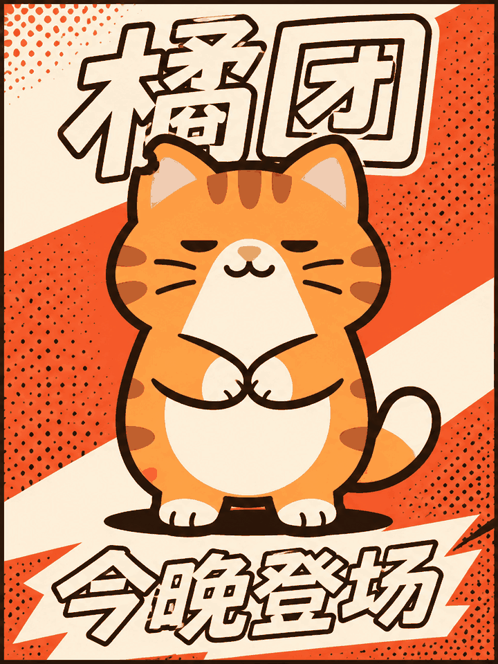
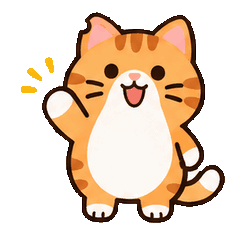
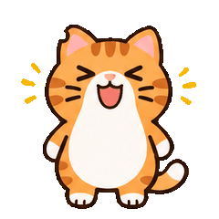
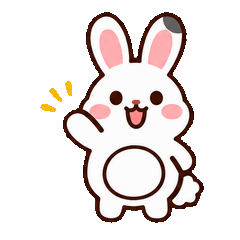
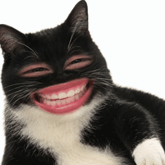
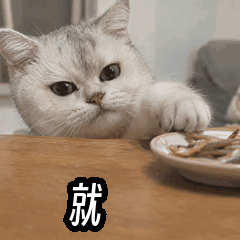
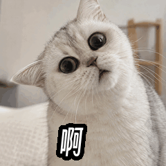
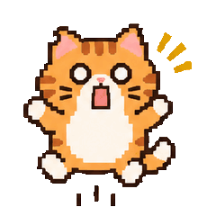
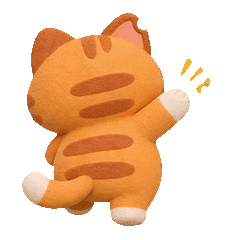

# awesome-ai-gif

用 AI 做各种 GIF 动图：表情包、光栅变画卡、动态海报……每一类一个 Skill，配上可复用的提示词和真实出图的案例。

> 定位：GIF 版 awesome-gpt-image。按**类型**组织，微信表情包只是其中一类。
> 出图：GPT Image 2.6 起步（Codex CLI 内置 image_gen 或 ChatGPT），案例结构不绑死单一模型。

## 支持的类型

| 光栅变画卡 | 动态海报 | 微信表情包 |
|---|---|---|
|  |  |     |

| 类型 | 做什么 | 规格 | Skill | 状态 |
|---|---|---|---|---|
| 微信表情包 | 一个角色做一整套聊天表情，能上架微信 | 240×240，≤500KB | [wechat-sticker](skills/wechat-sticker/SKILL.md) | 可用 |
| 光栅变画卡 | 同一画面的两种状态（日常 / 变身）竖条翻转切换，像实体光栅卡 | 480×720，6 秒 | [two-state-gif](skills/two-state-gif/SKILL.md) | 可用 |
| 动态海报 | “安静 / 登场”两张对齐的海报来回切换，字和画一起设计 | 720×960，4 秒 | [two-state-gif](skills/two-state-gif/SKILL.md) | 可用 |
| 动态签名 | 角色 + 名字，笔画逐笔写出 | 待定 | — | 规划中 |
| 动态绘本 | 多页连续画面讲一个小故事 | 待定 | — | 远期 |

不知道该用哪个，装总入口 [ai-gif](skills/ai-gif/SKILL.md)，它会按你说的话转到对应的 Skill。
不做：视频和带配音的短片、静态海报、配色方案（都不是 GIF），以及现有 IP、明星脸、真人肖像。这条管的是成品：灵感池里涉及真人、现成 IP 或视频路线的条目可以通过，但只借手法，做出来的仍是原创角色（或自家宠物）的 GIF。类型划分参考了 [gif-factory](https://github.com/WoYun520/gif-factory)，取舍理由见 [仓库规划.md](仓库规划.md) 的“系列规划”。

## 微信表情包

| 原创角色，从零做一套 | 同一套动作换个角色 | 自家猫的照片做梗图 | 多张照片按性格做一套 | 换画风：像素 / 黏土 |
|---|---|---|---|---|
|   |   |   |   |   |
| [橘团 9 张](trials/2026-11-16-codex-orange-cat/) | [白兔 9 张](trials/2026-11-17-remix-rabbit/)（复刻橘团） | [奶牛猫 19 张](trials/2026-11-18-snail-cat-remix/) | [多多 12 张](trials/2026-11-18-duoduo/)（偷感干饭精） | [各 4 张](trials/2026-11-18-gif-factory-styles/) |

每张都是 240×240 GIF、500KB 以内，都过了 Skill 自带的微信规格机检。

[skills/wechat-sticker/](skills/wechat-sticker/SKILL.md) 是给 Claude Code 或 Codex 用的 Skill，用户只说要什么，出图、验货、合成、加字、机检都由 Skill 带着走。

| 能力 | 说明 |
|---|---|
| **原创角色做一套** | 先定角色，再用一张 4×4 图集定下 16 个姿势、逐格加点头 / 弹跳 / 摇摆；要真动作（挥手、吃东西）的走六帧序列图；画风可选简笔、3D 毛绒、像素、黏土 |
| **宠物照片定稿** | 把自家猫狗的照片做成卡通角色；3D、毛绒这类没有描边的画风直接出透明底，白肚皮不会被抠掉 |
| **一套 GIF 换个角色** | 给一套已有的 GIF 和一个新角色，自动判断每张是“整体晃动”还是“真动作”，沿用原套每帧的时长重做一套 |
| **多张照片按性格做一套** | 上传自家宠物的多张照片，先看照片建档、问主人 3 个问题，归纳性格后给几个方向（各配画风），选定再排 12 张故事线出图 |
| **照片梗图换主角** | 一套静态的真实照片梗图（如猫脸 P 人嘴），换成你家宠物的真实照片风格，再加冲镜头、抖动、颠一下等镜头动效变成动图 |
| **后期加字** | 字由脚本压上去，不靠模型画：可逐字出现、竖排、把角色缩小给字让位；自带可免费商用的得意黑，缺字会提醒 |
| **Codex 自动出图** | 本机装了 Codex CLI 就能直接调内置生图，不需要 API Key；整套并行出图，重画时旧图自动保留 |
| **微信上架机检** | 查尺寸、体积、帧数、循环、首尾能否接上、整圈白边、整套重复度、含义词和文案字数，以及封面、图标、横幅 |
| **配套素材** | 封面、聊天面板图标、详情页横幅和专辑文案 |

## 光栅变画卡和动态海报

[skills/two-state-gif/](skills/two-state-gif/SKILL.md)：让模型在一张左右双联图里画出同一构图的两种状态，脚本切开对齐，做成“A 停留 → 竖条翻到 B → 停留 → 翻回”的循环 GIF。

- 两种规格开箱即用：`--spec card`（480×720，6 秒）、`--spec poster`（720×960，4 秒），尺寸、时长、条数都能覆盖。
- 体积可控：整段共用一张调色板、每帧只写变化区域，6 秒的卡不到 1MB（逐帧整张写约 5MB）。
- 模型把格子比例画错时会报错提醒，可用 `--crop-y` 选窗口，不会悄悄裁掉一大块。
- 可在底部加固定标题，每帧不闪。

## 灵感池：全网 AI 动图做法，按主题分好

做新类型之前先看别人怎么做。这里把全网能找到的 AI 动图教程、Skill、实测和案例收到一起，按主题分好类，每一类都能点进去看完整列表。

<!-- inspiration:start -->
收了 **1161** 条，每条都有出处链接和我们自己写的分析（它怎么做的、我们能借什么）。别人的图不入库，下面的配图都是我们自己做的。

| 主题 | 条数 | 能借到什么 | 我们做出来的 |
|---|---|---|---|
| [微信表情包：整套、上架与变现](inspiration/topics/wechat.md) | 44 | 从定角色到投稿的全流程、素材规格、被拒原因、赞赏和定制的变现路径 |   |
| [照片变表情：宠物、头像](inspiration/topics/photo.md) | 68 | 多张参考图锁角色、保长相只加微动、照片转 Q 版；真人部分不用，换自家宠物 |   |
| [图集与序列帧：九宫格、六帧、精灵表](inspiration/topics/sheets.md) | 117 | 一张图画完整套或整段动作、切图避开网格线、末帧接回首帧 |   |
| [动态海报、产品图与局部动效](inspiration/topics/posters.md) | 72 | 只动一个元素其余锁死、字不动背景动、按节拍排场、首帧能当封面 |  |
| [光栅卡、全息卡与贺卡](inspiration/topics/cards.md) | 22 | 两态对齐、翻转节奏、共享调色板、节日题材 |  |
| [游戏精灵与像素动画](inspiration/topics/game.md) | 115 | 多方向精灵表、行走循环、锚点和帧计划；像素画风的出图顺序 |   |
| [动态签名](inspiration/topics/signatures.md) | 24 | 签名卡的规格、首帧能独立成图、逐字出现的时序 | 还没做 |
| [动态绘本](inspiration/topics/storybooks.md) | 28 | 每页只做一个动作的拆页法、跨页角色一致、微动而不是大动作 | 还没做 |
| [手绘、涂鸦变动图](inspiration/topics/sketch.md) | 24 | 保留原笔触的提示思路、先净化成角色再加动作、孩子的画怎么动起来 | 还没做 |
| [提示词模板与公式](inspiration/topics/prompts.md) | 112 | 提示词分几段写、哪句管循环、哪句管一致性 | — |
| [实测、参数与避坑](inspiration/topics/tests.md) | 62 | 帧数和尺寸怎么配、成本多少、哪些动作会做坏、原生 GIF 的边界 | — |
| [开源 Skill 与工具](inspiration/topics/skills.md) | 143 | 别人的 Skill 怎么拆步骤、怎么做机检、怎么组织脚本和规格配置 | — |
| [视频模型与无缝循环](inspiration/topics/video.md) | 123 | 首尾同帧、藏接缝、补帧这些循环技法；我们只借思路，成品仍是 GIF | — |
| [代码动效：Lottie、SVG、逐帧渲染](inspiration/topics/code.md) | 33 | 不靠模型出图、用代码逐帧画的路线，适合文字和几何动效 | — |
| [其他平台贴纸：LINE、WhatsApp、Telegram、Discord](inspiration/topics/platforms.md) | 48 | 各平台的尺寸、格式和上架流程，留给多平台规格用 | — |
| [其他教程与资讯](inspiration/topics/misc.md) | 126 | 入门教程、功能发布、工具页 | — |
<!-- inspiration:end -->

全部条目和审批状态见 [灵感池看板](inspiration/README.md)。用法只有一种：借手法，换成原创角色重做，不搬别人的画面和提示词原文。

## 快速开始

1. 把要用的 Skill 文件夹拷到 `~/.claude/skills/`（Claude Code）或 Codex 的 skills 目录：全都要就拷整个 `skills/`，只要表情包就只拷 `skills/wechat-sticker/`。每个 Skill 都能单独用。
2. 装好 Python 3 和 Pillow（`pip install pillow`）。
3. 想自动出图：装好 [Codex CLI](https://github.com/openai/codex) 并登录。没有也能用：Skill 会把提示词给你，你在 ChatGPT 出图后把图交回来，后面的步骤照常。
4. 直接说你要什么，比如：
   - “把这只猫的照片做成一套微信表情包，10 张”
   - “用这个角色做一套像素风表情”
   - “把这几张猫梗图换成我家猫”
   - “给我的角色做一张光栅变画卡，日常喝牛奶，变身成超级英雄”
   - “做一张角色登场的动态海报，标题写‘今晚登场’”
   - “检查这套表情能不能上架微信”

> 复刻别人已上架的表情、别人的梗图，只适合练手：动作照抄只换角色属于未授权二创，微信审核会拒，也有侵权风险。Skill 遇到这种情况会先提醒。

## 只要提示词

打开 [prompts/](prompts/) 里的公式，换掉角色和动作，复制到 ChatGPT 出图。各 Skill 里还有精简版：表情包（含宠物照片定稿、照片梗图换主角、像素 / 黏土画风）见 [wechat-sticker/references/prompts.md](skills/wechat-sticker/references/prompts.md)，变画卡和海报见 [two-state-gif/references/prompts.md](skills/two-state-gif/references/prompts.md)。

| 公式 | 用途 |
|---|---|
| [角色定稿](prompts/character-sheet.md) | 第一步，定下整套的角色参考图 |
| [4×4 姿势图集](prompts/atlas-4x4.md) | 一次出 16 个姿势，再由脚本加点头、弹跳、摇摆 |
| [六帧序列图](prompts/sprite-sheet-6-frame.md) | 一个真实动作的 6 帧，合成循环 GIF |

## 当前状态

Skill 已用真实出图跑通六次试做，记录都在 [trials/](trials/)，每次都有提示词原文、出图日志和报告。变画卡和海报各跑通一张。还没有一套表情正式提交过微信，[cases/](cases/) 案例库目前是空的；排期见 [仓库规划.md](仓库规划.md)。

| 试做 | 内容 | 张数 |
|---|---|---|
| [2026-11-16 橘团](trials/2026-11-16-codex-orange-cat/) | 原创角色从零做一套，Codex 出图 | 9 |
| [2026-11-17 白兔](trials/2026-11-17-remix-rabbit/) | 用橘团那套换角复刻 | 9 |
| [2026-11-18 奶牛猫 3D](trials/2026-11-18-remix-tuxedo-cat/) | 宠物照片定稿成 3D 毛绒角色，复刻 3 张、加字 | 3 |
| [2026-11-18 奶牛猫照片梗图](trials/2026-11-18-snail-cat-remix/) | 真实照片风格换主角、镜头动效、加字 | 19 |
| [2026-11-18 多类型](trials/2026-11-18-gif-factory-styles/) | 光栅变画卡、动态海报，表情包加像素、黏土两种画风 | 卡 1、海报 1、表情 8 |
| [2026-11-18 多多](trials/2026-11-18-duoduo/) | 7 张照片建档 + 主人问答 → 定方向“偷感干饭精”，真实照片风格、镜头动效、加字 | 12 |

<!-- cases:start -->
案例总数：**0**（已上架 0）

| 系列 | 案例数 | 索引 |
|---|---|---|
| 微信表情包 | 0 | [查看](cases/wechat-stickers/README.md) |
<!-- cases:end -->

## 目录

- `skills/`：一类一个 Skill，各自带脚本和规格配置，可单独拷走
  - `ai-gif/`：总入口，判断类型后转到下面的子 Skill
  - `wechat-sticker/`：微信表情包，自带得意黑字体
  - `two-state-gif/`：光栅变画卡、动态海报
- `prompts/`：通用提示词公式
- `trials/`：Skill 试做记录（包括表情包以外类型的试做）
- `inspiration/`：灵感池，从全网收集的好 case 先放这里，带状态；**审批通过后才能用**，用法是换成原创角色重做（[规则](inspiration/README.md)）
- `cases/`：案例库，按“类型（系列）/ 分组 / 案例”组织，一类一个子目录，有第一个案例时再建；`cases/index.json` 是全量索引
- `tools/`：仓库维护脚本（`build_index.py` 生成案例索引，`inspiration.py` 管灵感池）
- `docs/`：[上架指南](docs/wechat-publishing.md)、[被拒原因](docs/rejections.md)、[成本实测表](docs/cost-log.md)
- `site/`：可视化站（阶段 2，未开始）

## 贡献

任何类型都欢迎，只收原创角色，每个案例都要有提示词原文、成品 GIF、成本和验收记录。详见 [CONTRIBUTING.md](CONTRIBUTING.md)。

## License

MIT。Skill 自带的得意黑字体是 SIL OFL 1.1，见 [skills/wechat-sticker/fonts/](skills/wechat-sticker/fonts/)。

## 致谢

对标苍何 awesome-gpt-image-2（提示词库三件套结构）；方法论参考 gif-factory（图集轻动效、Skill 组织方式，以及变画卡、动态海报等类型划分和规格）、ray-sticker-shop（上架流水线）、charmoji-sticker-skill（机检分级与差异哈希）、animated-sticker-studio（多平台规格）。六帧公式的骨架来自 OpenAI《Introducing Images 2.6》。字体来自 atelier-anchor 的得意黑（Smiley Sans）。
