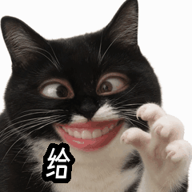

# awesome-ai-gif

用 AI 做 GIF 表情：一个能从头做到上架机检的微信表情包 Skill，加上可复用的提示词和案例。

> 定位：GIF 版 awesome-gpt-image。微信表情包是第一期，不是全部。
> 出图：GPT Image 2.6 起步（Codex CLI 内置 image_gen 或 ChatGPT），案例结构不绑死单一模型。

## 效果

| 原创角色，从零做一套 | 同一套动作换个角色 | 自家猫的照片做梗图 |
|---|---|---|
|   |   |   |
| [橘团 9 张](trials/2026-11-16-codex-orange-cat/) | [白兔 9 张](trials/2026-11-17-remix-rabbit/)（复刻橘团） | [奶牛猫 19 张](trials/2026-11-18-snail-cat-remix/) |

每张都是 240×240 GIF、500KB 以内，GIF 本身都过了 Skill 自带的微信规格机检。

## 微信表情包 Skill 能做什么

[skills/wechat-sticker/](skills/wechat-sticker/SKILL.md) 是给 Claude Code 或 Codex 用的 Skill，用户只说要什么，出图、验货、合成、加字、机检都由 Skill 带着走。

| 能力 | 说明 |
|---|---|
| **原创角色做一套** | 先定角色，再用一张 4×4 图集定下 16 个姿势、逐格加点头 / 弹跳 / 摇摆；要真动作（挥手、吃东西）的走六帧序列图 |
| **宠物照片定稿** | 把自家猫狗的照片做成卡通角色；3D、毛绒这类没有描边的画风直接出透明底，白肚皮不会被抠掉 |
| **一套 GIF 换个角色** | 给一套已有的 GIF 和一个新角色，自动判断每张是“整体晃动”还是“真动作”，沿用原套每帧的时长重做一套 |
| **照片梗图换主角** | 一套静态的真实照片梗图（如猫脸 P 人嘴），换成你家宠物的真实照片风格，再加冲镜头、抖动、颠一下等镜头动效变成动图 |
| **后期加字** | 字由脚本压上去，不靠模型画：可逐字出现、竖排、把角色缩小给字让位；自带可免费商用的得意黑，缺字会提醒 |
| **Codex 自动出图** | 本机装了 Codex CLI 就能直接调内置生图，不需要 API Key；整套并行出图，重画时旧图自动保留 |
| **微信上架机检** | 查尺寸、体积、帧数、循环、首尾能否接上、整圈白边、整套重复度、含义词和文案字数，以及封面、图标、横幅 |
| **配套素材** | 封面、聊天面板图标、详情页横幅和专辑文案 |

## 快速开始

1. 把 `skills/wechat-sticker/` 整个文件夹拷到 `~/.claude/skills/`（Claude Code）或 Codex 的 skills 目录。
2. 装好 Python 3 和 Pillow（`pip install pillow`）。
3. 想自动出图：装好 [Codex CLI](https://github.com/openai/codex) 并登录。没有也能用：Skill 会把提示词给你，你在 ChatGPT 出图后把图交回来，后面的步骤照常。
4. 直接说你要什么，比如：
   - “把这只猫的照片做成一套微信表情包，10 张”
   - “把这套 GIF 换成我的角色重做一套”
   - “把这几张猫梗图换成我家猫”
   - “给这张表情加上‘开饭了’，逐字出现”
   - “检查这套表情能不能上架微信”

> 复刻别人已上架的表情、别人的梗图，只适合练手：动作照抄只换角色属于未授权二创，微信审核会拒，也有侵权风险。Skill 遇到这种情况会先提醒。

## 只要提示词

打开 [prompts/](prompts/) 里的公式，换掉角色和动作，复制到 ChatGPT 出图。Skill 里还有一份带“宠物照片定稿”“照片梗图换主角”的精简版：[references/prompts.md](skills/wechat-sticker/references/prompts.md)。

| 公式 | 用途 |
|---|---|
| [角色定稿](prompts/character-sheet.md) | 第一步，定下整套的角色参考图 |
| [4×4 姿势图集](prompts/atlas-4x4.md) | 一次出 16 个姿势，再由脚本加点头、弹跳、摇摆 |
| [六帧序列图](prompts/sprite-sheet-6-frame.md) | 一个真实动作的 6 帧，合成循环 GIF |

## 当前状态

Skill 已用真实出图跑通四次试做，记录都在 [trials/](trials/)，每次都有提示词原文、出图日志和报告。还没有一套正式提交过微信，[cases/](cases/) 案例库目前是空的；排期见 [仓库规划.md](仓库规划.md)。

| 试做 | 内容 | 张数 |
|---|---|---|
| [2026-11-16 橘团](trials/2026-11-16-codex-orange-cat/) | 原创角色从零做一套，Codex 出图 | 9 |
| [2026-11-17 白兔](trials/2026-11-17-remix-rabbit/) | 用橘团那套换角复刻 | 9 |
| [2026-11-18 奶牛猫 3D](trials/2026-11-18-remix-tuxedo-cat/) | 宠物照片定稿成 3D 毛绒角色，复刻 3 张、加字 | 3 |
| [2026-11-18 奶牛猫照片梗图](trials/2026-11-18-snail-cat-remix/) | 真实照片风格换主角、镜头动效、加字 | 19 |

<!-- cases:start -->
案例总数：**0**（已上架 0）

| 系列 | 案例数 | 索引 |
|---|---|---|
| 微信表情包 | 0 | [查看](cases/wechat-stickers/README.md) |
<!-- cases:end -->

## 目录

- `skills/wechat-sticker/`：微信表情包 Skill，自带脚本、规格配置和字体
- `prompts/`：通用提示词公式
- `trials/`：Skill 试做记录
- `cases/`：案例库，按“系列 / 分组 / 案例”组织；`cases/index.json` 是全量索引
- `tools/`：仓库维护脚本
- `docs/`：[上架指南](docs/wechat-publishing.md)、[被拒原因](docs/rejections.md)、[成本实测表](docs/cost-log.md)
- `site/`：可视化站（阶段 2，未开始）

## 贡献

只收原创角色，每个案例都要有提示词原文、成品 GIF、成本和验收记录。详见 [CONTRIBUTING.md](CONTRIBUTING.md)。

## License

MIT。Skill 自带的得意黑字体是 SIL OFL 1.1，见 [skills/wechat-sticker/fonts/](skills/wechat-sticker/fonts/)。

## 致谢

对标苍何 awesome-gpt-image-2（提示词库三件套结构）；方法论参考 gif-factory（图集轻动效、Skill 组织方式）、ray-sticker-shop（上架流水线）、charmoji-sticker-skill（机检分级与差异哈希）、animated-sticker-studio（多平台规格）。六帧公式的骨架来自 OpenAI《Introducing Images 2.6》。字体来自 atelier-anchor 的得意黑（Smiley Sans）。
