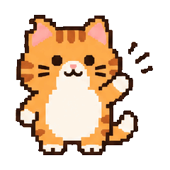
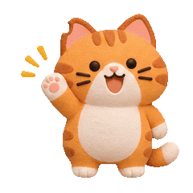
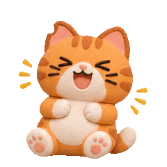
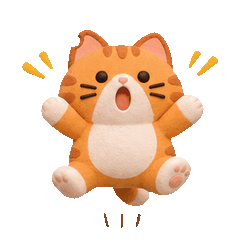
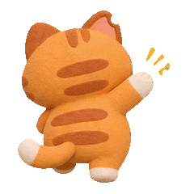
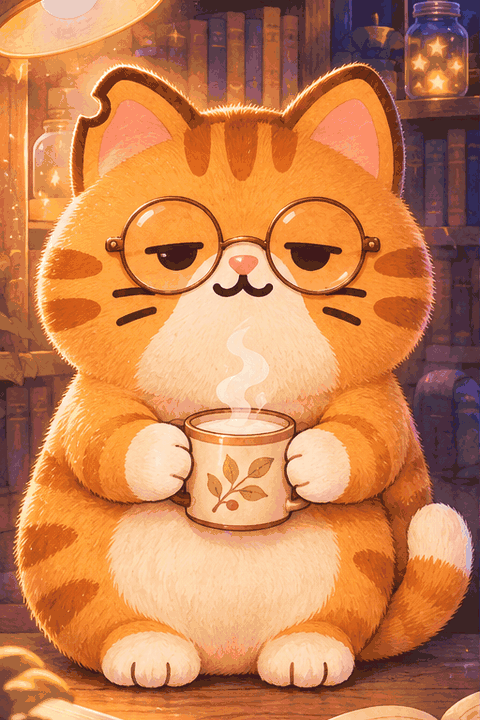
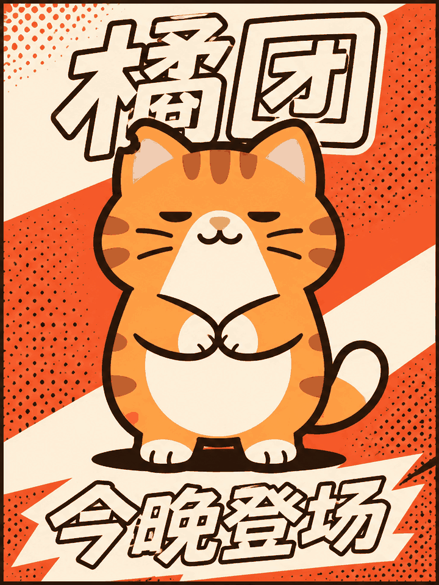

# 2026-11-18 gif-factory 类型试做

目的：微信表情包只是一类。对照 [gif-factory](https://github.com/WoYun520/gif-factory)（MIT）的类型清单，挑出产物是 GIF 的几类，用我们自己的流水线和原创角色橘团各跑一次，看哪些能收进仓库。结论写进了 [仓库规划.md](../../仓库规划.md) 的“系列规划”一节；变画卡和海报随后做成了 [two-state-gif](../../skills/two-state-gif/SKILL.md) Skill，像素、黏土并入了微信 Skill 的提示词。

gif-factory 的展示案例多用 IP 角色，这里不复刻它的任何画面，只借类型和规格。

## 结果

| 类型 | 成品 | 规格 | 出图 | 结论 |
|---|---|---|---|---|
| 表情包 · 像素风 |     | 240×240 | 4×4 图集 1 张，185s | 可收。16 格姿势都不同，特征件（右耳缺口、白尾巴尖）稳定 |
| 表情包 · 黏土吉祥物 |     | 240×240 | 4×4 图集 1 张，透明底，168s | 可收。透明底一次就干净 |
| 光栅变画卡 |  | 480×720，6 秒 | 双联图 1 张，126s | 可收，但提示词要改（见下） |
| 动态海报 |  | 720×960，4 秒 | 双联图 1 张，165s | 可收。两态对齐、字画得准 |

四张表情 GIF 都过了微信机检（`check_assets.py`：0 FAIL，WARN 都是套级素材缺失，试做不需要）。

## 做法

- 出图：`codex_gen.py each gen --image character.png`，每个子目录一段 `prompt.md`。黏土加 `--transparent`。
- 表情：`slice_sheet.py --cols 4 --rows 4` 切格，挑 4 格用 `light_motion.py` 加摇摆 / 弹跳；像素风白底加 `--key-white`，黏土透明底不加。
- 变画卡和海报：试做时写的脚本，已搬进 [two-state-gif Skill](../../skills/two-state-gif/SKILL.md) 成为 `two_state.py`（`--spec card` / `--spec poster`），A 停留 → 竖条从左到右错开翻到 B → B 停留 → 翻回，无限循环。整段共用一张调色板、每帧只写变化区域，6 秒 49 帧压到 885KB（直接逐帧整张写约 5MB）。

## 踩到的问题

1. **`codex_gen.py each` 的参考图说明写错**：子目录里没有 ref.png 时，说明仍写“最后 1 张是原图”，Codex 找不到就去翻磁盘、最后不出图（exit 0）。已修：按每张实际带的图写说明，没有就明说“不要去找”。
2. **变画卡比例没听话**：要的是两格 2:3 加底部窄深色条，出来每格约 512×1190、深色条占了 22%。这次用 `--crop-y 0.189:0.689` 从每格取一个 2:3 窗口。Skill 的提示词已改成直接写像素尺寸（“整张 1024×1536，左右各一格 512×768，不留空白条”）。
3. **海报 GIF 偏大**：网点纹理压缩差，255 色 1.5MB，降到 48 色 1.16MB，网点仍在。海报不受微信 500KB 限制，但入库体积要控制。
4. **像素风不是真像素**：模型画的“像素”不落在整齐网格上，缩到 240 时用 LANCZOS 不会更糊，也就没必要换最近邻。要严格像素对齐得另写“按网格取色重采样”的脚本，这次不做。
5. 脚本的位置参数要写在一起（`--split diptych.png out.gif`），夹在选项中间 argparse 会报错，文档已按这个写。

## 文件

- `pixel/`、`clay/`：各 4 张表情，`result.gif`
- `card/result.gif`、`poster/result.gif`
- `_work/gen/<类型>/`：提示词原文、出图日志、出图原图
- 主角图用 [橘团试做](../2026-11-16-codex-orange-cat/) 的 `character.png`，不重复入库
